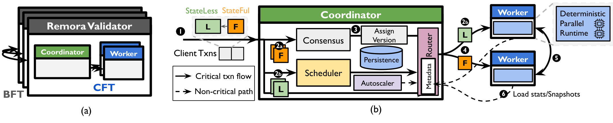

<p align="center">
  
</p>

<h1 align="center">Remora</h1>

<p align="center">
  <a href="https://doi.org/10.14778/3836663.3836674"></a>
  <a href="https://arxiv.org/abs/2607.02817"></a>
  <a href="#license"></a>
  
</p>

Remora is a scale-out execution engine for blockchain validators. It uses an asymmetric architecture where a single **primary** (coordinator) node handles consensus and scheduling, while a pool of **proxy** nodes execute smart contracts in parallel with strict determinism guarantees. See the VLDB 2026 paper, [*Remora: Scale-out Deterministic Execution for Smart Contracts*](https://doi.org/10.14778/3836663.3836674), and the [extended version](https://arxiv.org/abs/2607.02817) for more details.

<p align="center">
  
</p>

**System model**: Remora, as a single validator, inherits Byzantine Fault Tolerance (BFT) from the consensus layer (a), and internally scales out execution (b) with a centralized Coordinator and a pool of Workers under Crash Fault Tolerance (CFT).

## Highlights

As blockchain systems mature, the performance bottleneck is shifting from consensus to transaction execution. 
Smart contracts are becoming more compute-intensive due to increasingly heavier crypto verification, while existing scale-up approaches, such as parallel execution on a single multicore machine, fail to catch up.
Sustaining higher transaction throughput therefore requires **scale-out execution** across multiple machines.

- **Asymmetric architecture**: primary coordinator handles consensus/scheduling, proxy workers execute contracts
- **Strict determinism**: version-based execution ordering without coordination overhead
- **Stateless/stateful separation**: different scheduling policies for stateless crypto verification vs stateful execution
- **Consensus window optimization**: pre-consensus scheduling and stateless execution
- **Workload adaptiveness**: subgraph-first scheduling optimizes for locality and load balance
- **Elasticity**: dynamic proxy pool scaling without execution stalls

The implementation is ~13k lines of Rust and supports YCSB synthetic benchmarks, TPC-C database benchmarks, and real-world blockchain transactions (Sui). Remora design is agnostic to smart-contracts, as long as it can provide read/write sets in advance. We carefully discuss this limitation in our paper.

## Documentation

| Document | Contents |
|----------|----------|
| [docs/setup.md](docs/setup.md) | Building, configuration, running (local and distributed), testing, metrics and Grafana |
| [docs/architecture.md](docs/architecture.md) | System components, directory structure, and a paper-to-code map |

## Reference and DOI

Zhengqing Liu, Alberto Sonnino, Igor Zablotchi, Eleftherios Kokoris Kogias, and Marios Kogias. **Remora: Scale-out Deterministic Execution for Smart Contracts.** Proceedings of the VLDB Endowment, 19(11): 3076–3090, 2026. DOI: [10.14778/3836663.3836674](https://doi.org/10.14778/3836663.3836674).

[Extended version](https://arxiv.org/abs/2607.02817).

If you use Remora in your research, please cite:

```bibtex
@article{remora,
  title         = {Remora: Scale-out Deterministic Execution for Smart Contracts},
  author        = {Liu, Zhengqing and Sonnino, Alberto and Zablotchi, Igor and
                   Kokoris Kogias, Eleftherios and Kogias, Marios},
  journal       = {Proceedings of the VLDB Endowment},
  volume        = {19},
  number        = {11},
  pages         = {3076--3090},
  year          = {2026},
  doi           = {10.14778/3836663.3836674},
  url           = {https://doi.org/10.14778/3836663.3836674}
}
```

## License

Apache License 2.0. See source file headers for details.
